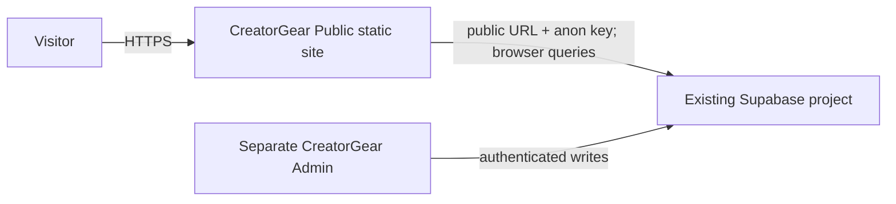

# CreatorGear Public Architecture

**Status:** client-rendered directory and profile foundation. Directory, profile, and association query logic is implemented. Live Supabase schema, anonymous RLS behavior, production hosting, and SEO output are not verified.

## 1. System context and boundaries



The public app is an independent repository and deployment from `silver_admin`. Supabase remains the shared source of truth. This codebase does not perform migrations, authenticated administration, or database writes. All browser requests are untrusted and constrained by Supabase authorization/RLS.

## 2. Frontend and routing

`src/main.tsx` mounts React under `BrowserRouter`. `src/App.tsx` owns the shared header/footer, route table, landing page, directory presentation, and data loaders. `src/lib/supabase.ts` creates a browser client only when both public environment values are present. `src/types.ts` contains the selected row shapes. CSS is in `src/style.css`.

| Route | Responsibility | Data |
| --- | --- | --- |
| `/` | Introductory discovery page | None |
| `/creators` | Search/list published creators | `creators` |
| `/creators/:slug` | Published creator profile and public gear associations | `creators`, active `creator_gear`, published `products` |
| `/products` | Search/list published products and type | `products`, related `product_types` |
| `/products/:slug` | Published product detail and public creator associations | `products`, active `creator_gear`, published `creators` |
| `*` | Not-found page | None |

Directories request up to 60 name-ordered rows, optionally use a name `ilike` filter, and show loading, configuration, error, or empty states. Directories are limited to 60 rows, and cross-search, SSR, and a server API are absent. Detail routes load one record by slug and separately query active associations, filtering each related creator/product to `published`. Both association directions use separate ID-based queries: fetch active association IDs, then load only published related records. This avoids retrieving details for unpublished related records and avoids depending on undocumented nested relationship aliases. Filter matching is convenience, not access control.

## 3. Data model and data flow

The admin repository documentation names these columns (not independently checked against the live project):

- `creators`: `id`, `name`, `slug`, `bio`, `country_name`, `follower_count`, `status`.
- `products`: `id`, `name`, `slug`, `description`, `image_url`, `product_type_id`, `status`.
- `product_types`: includes `id` and `name` and is referenced by `products.product_type_id`.
- `creator_gear`: documented as the creator/product association, with `creator_id`, `product_id`, verification/status fields.
- `affiliate_links`: product and retailer associations, with URL and status fields; not queried by this application.

```mermaid
sequenceDiagram
  participant V as Visitor browser
  participant UI as React directory
  participant S as Supabase API / RLS
  V->>UI: Open directory or enter search
  UI->>S: Select allowlisted columns; status = published
  S->>S: Apply grants and RLS
  S-->>UI: Rows or query error
  UI-->>V: List, empty state, or error state
```

The product directory/detail query requests `product_types(name)`. Creator/product association lookups use separate table queries keyed by IDs. Product-type relationship compatibility still depends on live PostgREST metadata and must be confirmed. Errors currently produce a generic visitor-facing message rather than exposing database details.

## 4. Public data rules and security boundary

The admin UI creates new creators and products with `status: draft`, and includes a creator publish action that can publish associated active products. This is evidence of an admin workflow, not proof of all public-read rules. Queries filter creators and products to `published`; association reads filter `creator_gear.status` to `active` and then retain only published related records. This is implemented query behavior, not verified public eligibility policy. Affiliate links are not queried. Validate anonymous access and visibility rules against live RLS before release.

No public RLS policy has been independently inspected. Verify anonymous `SELECT` policies, table grants, related-row visibility, and RLS on every table in the live Supabase project before release. A filtered browser query cannot prevent direct API access. Never use a service-role credential in this app. No auth/session UI is present. Do not modify database schema or policies from this project without explicit scope and reviewed impact.

## 5. Configuration and failures

Required client configuration: `VITE_SUPABASE_URL` and `VITE_SUPABASE_ANON_KEY`; `.env.example` contains placeholders and `.env.local` is ignored. Vite embeds these values in the client bundle, so only public credentials may be supplied. An absent setting is represented as a null client and directories show an unconfigured state. Request failures are caught and rendered as a generic error; empty results get a separate state. There is no retry control, telemetry, or structured error logging.

## 6. SEO, rendering, performance, deployment

The site is client-rendered and built as static assets by Vite. Only the document-level title/description exist. Per-route metadata, canonical URLs, sitemap, robots rules, structured data, and prerendering are TODOs. Render Static Site is the intended deployment target, not yet configured or verified. Browser routes need a host rewrite to `/index.html`. There is no explicit cache policy; the app relies on browser/Supabase defaults and requests at most 60 entries per directory. No image assets are requested in current cards.

## 7. Affiliate links and tracking

Affiliate URLs, retailer destinations, disclosure, outbound-link safety, and click tracking are not implemented. Before exposing those fields, verify schema and public eligibility, validate allowed protocols, use safe external-link attributes, add a clear disclosure, and decide whether tracking is permitted and privacy-compatible. No claim about live availability or functioning links is made.

## 8. Testing and verification strategy

Implemented package scripts: `npm run build` runs TypeScript project builds and Vite production build; `npm run lint` runs Oxlint; `npm run dev` starts Vite; `npm run preview` previews `dist`. Both after the initial setup and after adding detail routes, `npm run build` passed and `npm run lint` completed successfully. The latest production build emitted `dist/index.html`, CSS, and JavaScript bundle. No live Supabase request, browser route refresh, or production deployment was tested. Future verification should include anonymous public-data isolation, draft exclusion, relationship query behavior, error/empty states, direct route refreshes, accessibility, and production route smoke checks.

## 9. Architecture decisions (ADR)

### ADR-001 — Separate public website
- **Date:** 2026-10-10
- **Context:** Admin and public experiences have different trust boundaries and deployment lifecycles.
- **Decision:** Keep CreatorGear Public as a sibling project and separate repository/deployment; share Supabase as source of truth.
- **Alternatives considered:** Add public routes to the admin app; duplicate data in a separate database.
- **Reasoning:** Preserves the existing admin boundary and avoids a duplicate content source.
- **Consequences:** Public deployment/configuration and RLS validation are separate responsibilities.
- **Status:** Implemented as a separate folder; GitHub repository and deployment not created/verified.

### ADR-002 — Browser reads with public Supabase credential
- **Date:** 2026-10-10
- **Context:** Content should reflect admin-managed changes without a code redeploy.
- **Decision:** Query Supabase from the client with the public anon/publishable key and published status constraints.
- **Alternatives considered:** Hardcoded content; introduce a server endpoint at setup.
- **Reasoning:** Uses the shared source of truth and avoids storing public records in code.
- **Consequences:** RLS and grants are critical; actual anonymous read behavior is not yet verified. A backend may be needed if public access cannot be expressed safely under existing policies.
- **Status:** Client integration implemented; live compatibility pending.

### ADR-003 — Vite static client and BrowserRouter
- **Date:** 2026-10-10
- **Context:** Render Static Site is the intended host and the initial scope is a small public foundation.
- **Decision:** Use React/Vite static output with browser-side routes.
- **Alternatives considered:** Server rendering or static generation.
- **Reasoning:** Matches the requested static-hosting direction and existing admin toolchain.
- **Consequences:** Host rewrite is required; dynamic metadata and initial HTML content are limited until SEO strategy is chosen.
- **Status:** Implemented locally; Render behavior pending.

### ADR-004 — Restrict profile associations to active, published records
- **Date:** 2026-10-13
- **Context:** Creator and product profile pages need to connect records while avoiding draft or inactive entries in their displayed result set.
- **Decision:** Query active `creator_gear` rows and additionally filter associated creators/products to `published`; use separate ID-based reads in both directions, retrieving public fields only after applying the related record status filter.
- **Alternatives considered:** Query all associations and rely on client filtering alone; infer a nested relationship for both directions; show unpublished related content.
- **Reasoning:** The implementation follows documented status columns and evidenced foreign-key fields while minimizing assumptions about relationship names.
- **Consequences:** More than one query is required. These query filters do not replace RLS and do not prove intended public eligibility.
- **Status:** Implemented in client query code; live schema, anonymous RLS, and product-type relationship behavior remain unverified.
## 10. Risks, debt, and roadmap

1. **Blocking release risk:** Live schema, relationship metadata, anonymous grants, and RLS remain unverified.
2. Define publication eligibility for creator/product associations and affiliate links; test direct API access to drafts.
3. Decide safe affiliate-link presentation, disclosure, and any tracking.
4. Add pagination/cross-search based on dataset size and query plans.
5. Choose SEO/prerendering approach and validate metadata and structured data.
6. Perform accessibility, responsive, performance, and browser verification.
7. Configure Render, rewrite, environment settings, HTTPS, custom domain, rollback, and production smoke checks.
8. Decide on analytics and privacy obligations.


## 11. Current implementation checklist

- [x] Separate static app foundation and routes.
- [x] Published-only creator and product list query intent.
- [x] Search by name and basic load/error/empty/unconfigured UI states.
- [x] `npm run build` passed; `npm run lint` completed successfully.
- [x] Creator/product detail routes and association UI with published-state filters.
- [ ] Live Supabase schema/RLS/query and association verification.
- [ ] Affiliate features and SEO.
- [ ] Render deployment and production verification.


