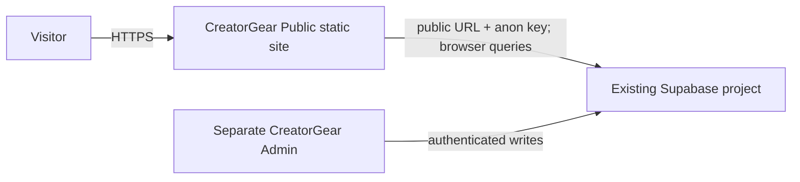

# CreatorGear Public Architecture

**Status:** client-rendered directory and profile foundation with conditional build-time sitemap generation. Directory/profile query shapes and selected live REST fields/relationships were verified read-only on 2026-10-13. RLS policy configuration, full public-data isolation, configured sitemap URL set, production hosting, and SEO output remain unverified.

## 1. System context and boundaries



The public app is an independent repository and deployment from `silver_admin`. Supabase remains the shared source of truth. This codebase does not perform migrations, authenticated administration, or database writes. All browser requests are untrusted and constrained by Supabase authorization/RLS.

## 2. Frontend and routing

`src/main.tsx` mounts React under `BrowserRouter`. `src/App.tsx` owns the shared header/footer, route table, landing page, paginated directory presentation, cross-search, route metadata, and data loaders. The shell includes a skip-to-content link, labeled search fields, live result announcements, and visible keyboard focus styles. `src/lib/supabase.ts` creates a browser client only when both public environment values are present. `src/types.ts` contains the selected row shapes. CSS is in `src/style.css`.

| Route | Responsibility | Data |
| --- | --- | --- |
| `/` | Introductory discovery page | None |
| `/search?q=...` | Cross-search published creators/products; up to 12 results per type | `creators`, `products` |
| `/creators` | Search/list published creators; 20 per page | `creators` |
| `/creators/:slug` | Published creator profile and public gear associations | `creators`, active `creator_gear`, published `products` |
| `/products` | Search/list published products and type; 20 per page | `products`, related `product_types` |
| `/products/:slug` | Published product detail and public creator associations | `products`, active `creator_gear`, published `creators` |
| `*` | Not-found page | None |

Directories request 20 name-ordered rows per page with an exact count and optional name `ilike` filter. Search terms escape backslash, `%`, and `_` before adding the surrounding contains-match wildcards, so typed wildcard characters are treated literally. Local live-data browser checks for `%`, `_`, and backslash in creator search, `%` in gear search, and `%` in cross-search returned no matches rather than broadening to the current published set. Other special-character behavior and unusual database values have not been exhaustively tested. Previous/next controls page through results. Cross-search runs creator and product name queries in parallel and shows at most 12 of each type. Search runs when the visitor submits the shared-header or search-page form. Loading, configuration, error, and empty states are provided. SSR and a server API are absent. Detail routes load one record by slug and separately query active associations, filtering each related creator/product to `published`. Both association directions use separate ID-based queries: fetch active association IDs, then load only published related records. This avoids retrieving details for unpublished related records and avoids depending on undocumented nested relationship aliases. Filter matching is convenience, not access control.

## 3. Data model and data flow

The admin repository documentation names these columns. Read-only live REST checks on 2026-10-13 confirmed the selected creator, product, and association columns described below, as well as the product-type relationship. These sampled checks do not prove every column, constraint, policy, or record.

- `creators`: `id`, `name`, `slug`, `bio`, `country_name`, `follower_count`, `status`.
- `products`: `id`, `name`, `slug`, `description`, `image_url`, `product_type_id`, `status`.
- `product_types`: includes `id` and `name` and is referenced by `products.product_type_id`.
- `creator_gear`: documented as the creator/product association, with `creator_id`, `product_id`, verification/status fields.
- `affiliate_links`: product and retailer associations, with URL and status fields; not queried by this application.

```mermaid
sequenceDiagram
  participant V as Visitor browser
  participant UI as React directory
  participant S as Supabase API / RLS
  V->>UI: Open directory or enter search
  UI->>S: Select allowlisted columns; status = published
  S->>S: Apply grants and RLS
  S-->>UI: Rows or query error
  UI-->>V: List, empty state, or error state
```

The product directory/detail query requests `product_types(name)`; this relation returned HTTP 200 in a sampled anonymous REST check on 2026-10-13. Creator/product association lookups use separate table queries keyed by IDs. Other relationship metadata remains unverified. Errors currently produce a generic visitor-facing message rather than exposing database details.

## 4. Public data rules and security boundary

The admin UI creates new creators and products with `status: draft`, and includes a creator publish action that can publish associated active products. This is evidence of an admin workflow, not proof of all public-read rules. Queries filter creators and products to `published`; association reads filter `creator_gear.status` to `active` and then retain only published related records. This is implemented query behavior, not verified public eligibility policy. Read-only anonymous REST requests accepted the tested fields and filters and returned one row per sampled endpoint. This demonstrates effective access for those requests only; it does not establish that RLS is enabled or explain the policy/grant path. Affiliate links are not queried. Validate anonymous access and visibility rules against live RLS before release.

No public RLS policy or table grant has been independently inspected. Verify RLS enabled state, anonymous `SELECT` policies, grants, related-row visibility, and draft/unpublished isolation on every relevant live table before release. A filtered browser query cannot prevent direct API access. Never use a service-role credential in this app. No auth/session UI is present. Do not modify database schema or policies from this project without explicit scope and reviewed impact.

The read-only catalog review is prepared in `supabase/audit_public_access.sql`. It reports RLS flags, policy expressions, public-schema usage, and table/column grants for creators, products, creator gear, product types, affiliate links, and retailers. It must be run by an authorized database operator; no policy changes are included.

A read-only anonymous request for draft creator/product IDs returned zero rows for each table on 2026-10-13. This is inconclusive: the check cannot distinguish absence of draft rows from rows hidden by RLS, and it does not prove RLS is enabled.

## 5. Configuration and failures

Required client configuration: `VITE_SUPABASE_URL` and `VITE_SUPABASE_ANON_KEY`; `.env.example` contains blank placeholders and `.env.local` is ignored. Optional `VITE_SITE_URL` supplies the eventual public origin for canonical-link generation. Leave it unset until a real origin is chosen. Vite embeds these values in the client bundle, so only public credentials may be supplied. An absent Supabase setting is represented as a null client and directories show an unconfigured state. Request failures are caught and rendered as a generic error; empty results get a separate state. There is no retry control, telemetry, or structured error logging.

## 6. SEO, rendering, performance, deployment

The site is client-rendered and built as static assets by Vite. The app sets route-specific document titles and descriptions in the browser; these are not server-rendered. When `VITE_SITE_URL` is configured, it also generates canonical links for supported routes. Loaded creator and product detail pages inject Schema.org `Person` and `Product` JSON-LD into the document head using their already-loaded fields; product offers/pricing and creator identity URLs are omitted because those values are not currently sourced. This data is client-injected and has not been inspected in a browser or validated for rich-result eligibility. The production build script `scripts/generate-sitemap.mjs` uses the same optional origin and public Supabase settings to fetch published creator/product slugs and generate `dist/sitemap.xml`; it writes a basic `dist/robots.txt` and includes a Sitemap directive only when sitemap generation succeeds. Without a valid origin or complete public Supabase configuration, the sitemap is skipped and robots has no Sitemap directive. This is a snapshot: new published slugs enter the sitemap after the next build/deploy. Configured output and live sitemap contents have not been verified. Prerendering remains TODO. `render.yaml` defines a Render static site with the npm build, `dist` publish directory, catch-all SPA rewrite to `/index.html`, Node 22.12.0, and unset public build variables. The blueprint has not been deployed or validated by Render. There is no explicit cache policy; the app relies on browser/Supabase defaults and requests 20 entries per directory page and at most 12 search results per entity type. No image assets are requested in current cards.

## 7. Affiliate links and tracking

Affiliate URLs, retailer destinations, disclosure, outbound-link safety, and click tracking are not implemented. Before exposing those fields, verify schema and public eligibility, validate allowed protocols, use safe external-link attributes, add a clear disclosure, and decide whether tracking is permitted and privacy-compatible. No claim about live availability or functioning links is made.

## 8. Testing and verification strategy

Implemented package scripts: `npm run build` runs TypeScript project builds, Vite production build, and conditional sitemap generation; `npm run lint` runs Oxlint; `npm run dev` starts Vite; `npm run preview` previews `dist`. The Render Blueprint YAML parsed successfully and its expected service, build, publish, rewrite, and environment-variable fields were checked, but it has not been submitted to Render. The build and linter passed after the initial setup, profile routes, pagination/search, keyboard-accessibility, canonical-link updates, conditional sitemap generation, structured data, and search-pattern escaping. The latest production build emitted `dist/index.html`, CSS, and JavaScript bundle; missing-origin sitemap skip behavior was also observed. Read-only live Supabase REST checks were performed on 2026-10-13: creator/product/association selected fields, published/active filters, and the product-type relation each returned HTTP 200 with one sampled row; values were not inspected. This is query-shape/effective-access evidence, not an RLS policy audit. A local browser smoke check rendered creator and gear directories and a published creator detail route. Creator-directory searches for `%`, `_`, and `\\`, gear-directory search for `%`, and cross-search for `%` returned no broadened results against current published data. The browser interface did not expose document-head JSON-LD contents. Production route refreshes/deployment were not tested. Future verification should include anonymous public-data isolation, draft exclusion, relationship query behavior, error/empty states, direct route refreshes, accessibility, inspecting structured data, and production route smoke checks.

## 9. Architecture decisions (ADR)

### ADR-001 — Separate public website
- **Date:** 2026-10-10
- **Context:** Admin and public experiences have different trust boundaries and deployment lifecycles.
- **Decision:** Keep CreatorGear Public as a sibling project and separate repository/deployment; share Supabase as source of truth.
- **Alternatives considered:** Add public routes to the admin app; duplicate data in a separate database.
- **Reasoning:** Preserves the existing admin boundary and avoids a duplicate content source.
- **Consequences:** Public deployment/configuration and RLS validation are separate responsibilities.
- **Status:** Implemented as a separate folder; GitHub repository and deployment not created/verified.

### ADR-002 — Browser reads with public Supabase credential
- **Date:** 2026-10-10
- **Context:** Content should reflect admin-managed changes without a code redeploy.
- **Decision:** Query Supabase from the client with the public anon/publishable key and published status constraints.
- **Alternatives considered:** Hardcoded content; introduce a server endpoint at setup.
- **Reasoning:** Uses the shared source of truth and avoids storing public records in code.
- **Consequences:** RLS and grants are critical; actual anonymous read behavior is not yet verified. A backend may be needed if public access cannot be expressed safely under existing policies.
- **Status:** Client integration implemented; sampled live query compatibility confirmed, while complete schema and authorization behavior remain unverified.

### ADR-003 — Vite static client and BrowserRouter
- **Date:** 2026-10-10
- **Context:** Render Static Site is the intended host and the initial scope is a small public foundation.
- **Decision:** Use React/Vite static output with browser-side routes.
- **Alternatives considered:** Server rendering or static generation.
- **Reasoning:** Matches the requested static-hosting direction and existing admin toolchain.
- **Consequences:** Host rewrite is required; dynamic metadata and initial HTML content are limited until SEO strategy is chosen.
- **Status:** Implemented locally; Render behavior pending.

### ADR-004 — Paginate directories and bound cross-search results
- **Date:** 2026-10-13
- **Context:** A fixed first-page list cannot scale as published data grows, and visitors need one place to search creators and products.
- **Decision:** Request 20 rows per directory page with exact counts and range pagination; query both entity types in parallel for cross-search and return at most 12 results per type.
- **Alternatives considered:** Load all rows in the browser; add a server search service; introduce infinite scrolling at initial launch.
- **Reasoning:** Uses existing Supabase filters, keeps requests bounded, and provides predictable navigation without new infrastructure.
- **Consequences:** Exact counts add query work; search is submit-driven and capped, and pagination/search need validation on realistic data volumes.
- **Status:** Implemented; live performance and browser interaction have not been tested.

### ADR-005 — Restrict profile associations to active, published records
- **Date:** 2026-10-13
- **Context:** Creator and product profile pages need to connect records while avoiding draft or inactive entries in their displayed result set.
- **Decision:** Query active `creator_gear` rows and additionally filter associated creators/products to `published`; use separate ID-based reads in both directions, retrieving public fields only after applying the related record status filter.
- **Alternatives considered:** Query all associations and rely on client filtering alone; infer a nested relationship for both directions; show unpublished related content.
- **Reasoning:** The implementation follows documented status columns and evidenced foreign-key fields while minimizing assumptions about relationship names.
- **Consequences:** More than one query is required. These query filters do not replace RLS and do not prove intended public eligibility.
- **Status:** Implemented in client query code; RLS policy configuration and unpublished-record isolation remain unverified.

### ADR-006 — Make canonical origin optional until the public domain is selected
- **Date:** 2026-10-13
- **Context:** Route-specific canonical URLs need an absolute origin, and the public domain has not been chosen.
- **Decision:** Accept optional `VITE_SITE_URL` and emit canonical links for supported routes only when it contains a valid HTTP(S) origin.
- **Alternatives considered:** Invent a temporary production domain; emit invalid/relative canonical links; postpone all canonical support.
- **Reasoning:** Provides implementation without asserting an unselected domain.
- **Consequences:** Canonical links are absent until deployment config is supplied; metadata remains client-rendered and must be validated on the live site.
- **Status:** Implemented; live canonical URLs not verified.

### ADR-007 — Generate the sitemap during production builds
- **Date:** 2026-10-13
- **Context:** Search engines need absolute routes for published creator and product profiles, but the public site origin is not selected.
- **Decision:** Extend the production build with a script that conditionally fetches published slugs from Supabase and writes a sitemap and robots file only when the origin and public configuration are valid.
- **Alternatives considered:** Hardcode a temporary domain; fetch the sitemap dynamically per request; omit sitemap support.
- **Reasoning:** Keeps the static hosting model and avoids inventing an origin while generating profile URLs from the shared source of truth.
- **Consequences:** The sitemap is a build-time snapshot, anonymous Supabase visibility determines which slugs are included, and the site must be rebuilt after slug changes. A configured fetch/output has not yet been verified.
- **Status:** Implemented; only the missing-origin skip path is verified.

### ADR-008 — Add conservative structured data to detail pages
- **Date:** 2026-10-13
- **Context:** Creator and gear detail pages can expose basic entity metadata for search engines, but richer commercial/identity fields are not established in the current data contract.
- **Decision:** Inject Schema.org `Person` JSON-LD for creators and `Product` JSON-LD for gear after the published record loads, using only its existing name, description, image, and product category fields.
- **Alternatives considered:** Add unsupported pricing, offer, social identity, or brand claims; add a server-side metadata service; omit structured data.
- **Reasoning:** Provides truthful basic entities without expanding the data model or inventing values.
- **Consequences:** The data is client-rendered with the rest of page metadata; browser inspection and search-engine rich-result eligibility remain unverified. Server rendering or prerendering may be needed for more reliable indexing.
- **Status:** Implemented; output and rich-result eligibility not verified.

### ADR-009 — Treat search wildcard characters as literal input
- **Date:** 2026-10-13
- **Context:** Directory and cross-search use `ilike` contains matching, where `%` and `_` otherwise act as pattern wildcards.
- **Decision:** Escape backslash, `%`, and `_` in visitor input before adding the intentional surrounding `%` wildcards.
- **Alternatives considered:** Preserve user-supplied wildcard behavior; switch to a separate search service.
- **Reasoning:** Search behaves like literal text entry and avoids broad matches from accidental wildcard characters.
- **Consequences:** Live checks for `%`, `_`, and backslash in creator search, `%` in gear search, and `%` in cross-search did not broaden results against current data; other characters and data cases are not verified.
- **Status:** Implemented; partial live browser check passed.

### ADR-010 — Prepare Render static-site deployment as a Blueprint
- **Date:** 2026-10-13
- **Context:** The Vite SPA needs a static host with a client-route rewrite and build-time public environment configuration.
- **Decision:** Add a `render.yaml` Blueprint for a Render static site that builds with `npm ci && npm run build`, publishes `dist`, rewrites client paths to `/index.html`, and requires public Supabase/site-origin variables to be configured in Render.
- **Alternatives considered:** Leave host configuration as dashboard-only steps; choose a different hosting provider; embed deployment values in source.
- **Reasoning:** Makes the intended setup reviewable and repeatable without inventing an account, domain, or credentials.
- **Consequences:** The Blueprint still needs a connected repository, configured public values, an assigned/chosen origin, and a successful Render deploy. Build-time sitemap/canonical features remain off until the origin is set.
- **Status:** Prepared; not deployed or verified on Render.
## 10. Risks, debt, and roadmap

1. **Blocking release risk:** Sampled REST query shapes work, but RLS enabled state, policy/grant configuration, and unpublished-record isolation remain unverified.
2. Run `supabase/audit_public_access.sql` through an authorized Supabase SQL session and review the result before launch.
3. Define publication eligibility for creator/product associations and affiliate links; verify draft isolation.
4. Decide safe affiliate-link presentation, disclosure, and any tracking.
5. Measure pagination and cross-search query performance using realistic data volumes.
6. Choose prerendering strategy; validate configured canonical, sitemap, robots, and JSON-LD output.
7. Perform accessibility, responsive, performance, and browser verification.
8. Configure Render, rewrite, environment settings, HTTPS, custom domain, rollback, and production smoke checks.
9. Decide on analytics and privacy obligations.


## 11. Current implementation checklist

- [x] Separate static app foundation and routes.
- [x] Published-only creator and product list query intent.
- [x] Search by name and basic load/error/empty/unconfigured UI states.
- [x] Cross-search, 20-row directory pagination, and route-specific client-side titles/descriptions.
- [x] Skip navigation, labeled search inputs, polite result announcements, and visible keyboard focus styles.
- [x] `npm run build` passed; `npm run lint` completed successfully.
- [x] Creator/product detail routes and association UI with published-state filters.
- [x] Sampled live REST schema/query compatibility for selected fields, filters, and product-type relation.
- [ ] RLS policy/grant review and unpublished-record isolation.
- [x] Prepared a read-only SQL audit for table RLS state, policies, grants, and schema usage; execution pending an authorized database session.
- [ ] Resolve whether zero anonymous draft rows means no drafts exist or RLS hides them; verify with an authorized database-side policy review.
- [x] Optional canonical-link support for configured deployment origin.
- [x] Conditional production sitemap and robots generation from published creator/product slugs; missing-origin behavior verified, configured live output pending.
- [x] Client-side Schema.org JSON-LD for loaded creator and product detail pages; browser output and rich-result eligibility pending verification.
- [x] Escape wildcard characters in directory and cross-search input; creator `%`, `_`, and backslash, gear `%`, and cross-search `%` checks passed against current live data.
- [x] Prepared Render static-site Blueprint; Render account setup and deployment remain pending.
- [ ] Set site origin and validate canonicals, sitemap, robots, and JSON-LD; complete SEO validation.
- [ ] Rebuild/redeploy after published creator or product slug changes to refresh the sitemap snapshot.
- [ ] Affiliate features.
- [ ] Render deployment and production verification.


